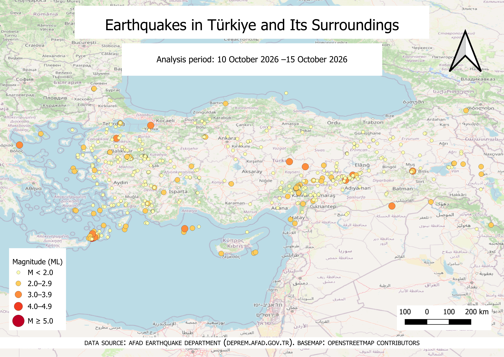
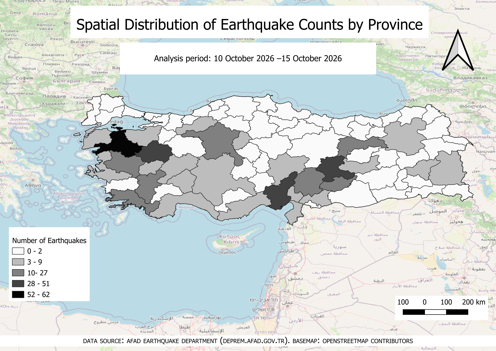

# AFAD Earthquake Analysis in QGIS

Four QGIS exercises using earthquake records from the AFAD Event Web Service:
point layer, magnitude symbology, counts by province, and a choropleth map.

## Data
- Source: AFAD Event Web Service (https://deprem.afad.gov.tr/event-service)
- Period covered: 10 Oct 2026 – 15 Oct 2026 (UTC)
- Records: 546
- Note: the service returns only the 1,000 most recent events, so the requested
  range (15 Sep – 15 Oct) was effectively limited to 10–15 Oct.
- Province boundaries: provided by the course instructor as part of the course material; not included in this repository

## 1. Earthquake point layer
- CSV imported as delimited text (X = longitude, Y = latitude, EPSG:4326)
- Exported to GeoPackage
- Largest magnitude: 4.1 (ML); deepest event: 65.61 km

## 2. Magnitude symbology
- Graduated symbology, 5 classes; size and color increase with magnitude

## 3. Earthquake counts by province
- "Join attributes by location (summary)", predicate: intersects, count of EventID
- NULLs converted to 0 with coalesce → EQ_COUNT
- Offshore events fall outside province polygons and are not counted
- Highest count: [Balıkesir] ([62] events)

## 4. Choropleth map
- Graduated polygon symbology on EQ_COUNT, 5 classes, [Natural Breaks] used in the final map

## Structure
`data/` · `assignment1_point_layer/` · `assignment2_magnitude_symbology/` ·
`assignment3_count_by_province/` · `assignment4_choropleth/`