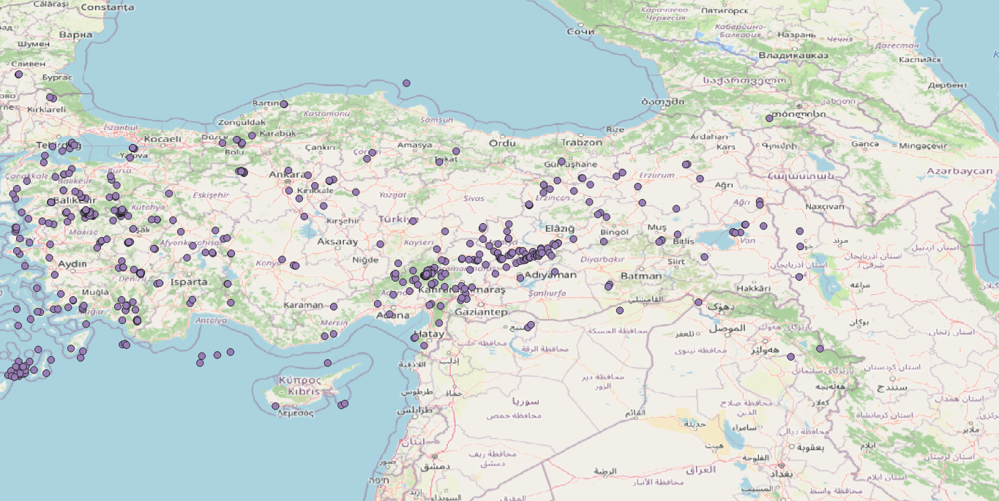

# AFAD Earthquake Data in QGIS

Downloads earthquake records from the AFAD Event Web Service,
converts them to Excel, and builds a point layer in QGIS (EPSG:4326).

## Data
- Source: AFAD Event Web Service (https://deprem.afad.gov.tr/event-service)
- Date range: 2026-9-15 to 2026-10-15
- Records: <kayıt sayın>

## Files
- `data/` – CSV, XLSX and GeoPackage
- `qgis/` – QGIS project
- `images/` – map screenshot

## Workflow
1. Download CSV from AFAD
2. Check columns in Excel
3. Add delimited text layer (X = longitude, Y = latitude, EPSG:4326)
4. Export to GeoPackage

